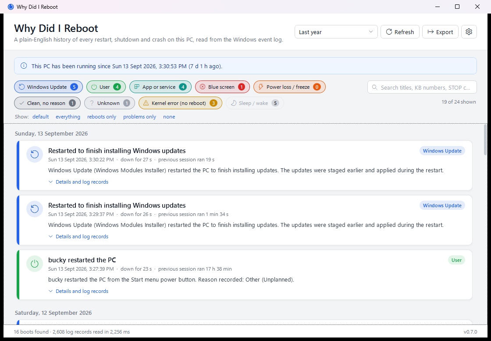

# Why Did I Reboot

A small Windows app that answers one question: **why did this PC restart?**

It reads the Windows event log and shows one plain-English card per restart: Windows Update, a person or an app asking for it, a blue screen (with the STOP code, the driver the crash dump points to, and the dump file), a power cut, a forced power-off, or a sleep/wake cycle.

## Download

Get **WhyDidIReboot.exe** from the [latest release](https://github.com/WelFedTed/why-did-i-reboot-releases/releases/latest). It is a single file that runs on any 64-bit Windows 10 or 11 PC with nothing else installed. No installer and no admin rights are needed. Some crash dumps can only be read as administrator, and the shield button in the app restarts it that way when you need it.

The app checks this page for new versions when it starts (you can turn that off in Settings), and **Update now** in Settings downloads the new version, verifies it and restarts.

**Coming from a version older than 0.15.0?** Those look for updates in a location that no longer exists. Download the latest release here once; it updates itself from then on.

## What it does

- One card per restart, newest first, colour-coded: Windows Update, User, App or service, Blue screen, Power loss / freeze, Clean (no reason), Unknown, Kernel error (no reboot), Sleep / wake.
- Blue screens decoded: STOP code and name, a one-line hint, the driver the crash dump points to, and links to Microsoft's reference page.
- Crash tools: open the dump in WinDbg, search the web for the crash, or ask an AI chat service (ChatGPT, Copilot, Perplexity or Claude) with WinDbg's analysis attached.
- Updates installed before a restart, with descriptions and links to Microsoft's KB articles.
- Filters, search, light and dark themes.
- Export as an HTML, text or CSV report, or as a .zip that carries the crash dumps so the report can be opened and analysed on another PC.
- Reads another Windows installation's logs (a second drive or a copied Windows folder).

## Privacy

Everything is read and analysed on your PC; there is no telemetry and no account. The app connects to the internet only to check this page for updates, and when you click something that opens a web page (Microsoft's reference pages, a web search, a chat service) or installs WinDbg.

## Feedback

Found a wrong explanation or a bug? [Open an issue](https://github.com/WelFedTed/why-did-i-reboot-releases/issues), ideally with the card's "Copy this entry" text.

---

Why Did I Reboot is free to download and use. It is not open source; the source code is not published. Copyright © 2026 WelFedTed. All rights reserved.
